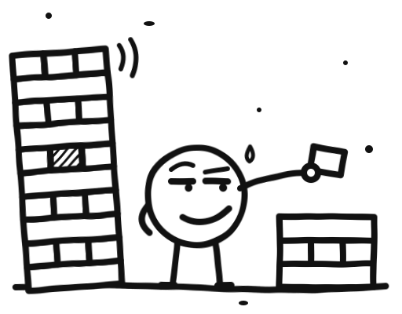

<p align="center">
  <picture>
    <source media="(prefers-color-scheme: dark)" srcset="assets/logo-dark.svg">
    
  </picture>
</p>

# pullstack

A universal agent skill that takes the best features from another project and rebuilds them in yours. Point it at a repository, or at an app with no repo at all (an Electron bundle, an APK, a .NET binary, a website), and it tells you what that project does that yours doesn't, with evidence. You pick what to take. It then plans and builds it in your project's own style.

The other project is only ever read, never run.

## Skills

| Skill | Say | Does |
|---|---|---|
| `pullstack` | "pullstack <repo or app>", "take features from X" | Compares X with your project, ranks what's worth taking, waits for your pick, then plans and builds it |
| `pullstack-update` | "X shipped v2, anything new?" | Reports only what changed in X since the version you ported from |
| `pullstack-check` | "did this branch copy from X?" | Finds lines copied word for word and checks the licence and attribution |
| `pullstack-help` | "pullstack help" | A one-screen reference card |

## Why

Ask an agent to "take the good parts of X" and it usually gets the comparison roughly right. What it gets wrong is the part you act on. In the test runs that shaped this skill, an agent without it:

- said the current project "already has equal or better" versions of six features, without pointing at any code;
- went straight from analysis to a build order, with no point where a human chose what to take;
- would have pulled about 100k tokens of someone else's code into the main session.

It did catch the licence that time (AGPL into a closed project). Nothing made it check, though. pullstack makes each of those a required step.

## What it does

1. Records your project's licence and the other project's commit, or the artifact's SHA-256.
2. Fetches the other project as untrusted data: a shallow clone or an extraction. Nothing in it gets installed, built or executed, and instructions written inside it (a README, an `AGENTS.md`) are ignored.
3. Settles the licence route before looking at a single feature: copy with notice, or ideas only.
4. Hands the reading to a subagent, so the other project's code never lands in your main session. The subagent writes a report around a feature matrix where every row cites a file and line on both sides. "We already have this" has to point at the code. "We don't" has to say what was searched.
5. Shows you the ranked TAKE list and waits. Nothing is planned until you choose.
6. Plans one task per chosen feature and builds them in a separate branch, one at a time, reviewing each before the next. Tasks on the ideas-only route are checked for lines copied verbatim from the other project.
7. Deletes the clone or extraction as soon as the report exists. Each new run first clears anything an earlier run left behind.

## Two routes

With a repo, you give it a URL or a path and it compares source with source.

Without one, you give it the artifact and it follows `references/artifact-route.md`:

| Artifact | How it is opened |
|---|---|
| Electron app | `app.asar` unpacked, original TypeScript recovered from shipped source maps, IPC channels listed |
| Website | public page assets and their source maps, with no login and no crawling |
| HAR capture you provide | read as JSON, never replayed |
| `.zip`, APK, `.jar`, wheel | unzipped; APK manifest read first |
| .NET assembly | decompiled to a C# project with `ilspycmd` |
| PyInstaller binary | extracted with `pyinstxtractor-ng` |
| UPX-packed binary | unpacked with `upx -d`, both hashes recorded |
| Native ELF / PE | linked libraries, exports, strings |
| Archive or firmware image | `7z`, then recurse |

Every claim in a no-repo report is labelled `observed` (read in a file), `inferred` (reasoned from names or strings) or `unknown` (needs the app running). Decompiled code is only for reading. It never goes into your project.

## Safety

Every extractor and decompiler runs through `scripts/sandbox.sh`, inside a throwaway container on the [gVisor](https://gvisor.dev) runtime. gVisor gives the container its own kernel rather than sharing yours. Each run gets:

- no network and no Linux capabilities
- a read-only image, with the artifact mounted read-only
- 2 GB of RAM including a 1 GB work disk, 2 CPUs at low priority, and a 10-minute limit
- output copied back only when the command succeeds, with every symlink removed

If Docker or gVisor is missing, the skill stops. It never falls back to extracting on your machine.

Tested against, and repeatable with `sh skills/pullstack/scripts/selftest.sh`:
- a 3 GiB zip bomb: stopped inside the container, nothing copied out
- `../` path traversal: kept inside the output folder
- a symlink pointing at `~/.ssh`: deleted
- network access: unreachable
- a 3 GB memory allocation: killed

## Licence routes

| Other project's licence | What you may bring into a closed or permissive project |
|---|---|
| MIT, BSD, ISC, Apache-2.0, Unlicense, 0BSD | Code, keeping the copyright notice and licence text (Apache: also `NOTICE`) |
| MPL-2.0 | Whole files, which stay MPL |
| LGPL | Use it as a dependency; copying its source in makes it copyleft |
| GPL, AGPL | Ideas only, unless your project is GPL/AGPL already |
| None, or a closed app | Ideas only |

"Ideas only" means reading the other project for behaviour and edge cases, then writing new code against your own helpers. A line-by-line translation still counts as a copy. Many closed apps' licence agreements also forbid decompiling, and the report flags that. None of this is legal advice.

## Install

```bash
npx skills add VenTheZone/pullstack -g
```

That uses the [skills CLI](https://github.com/vercel-labs/skills). To install by hand, copy the four folders in `skills/` into your agent's skills folder and keep them side by side. [INSTALL.md](INSTALL.md) has both, plus the sandbox setup.

You need `git` and `python3`. Targets with no repo also need Docker with the gVisor `runsc` runtime, which only runs on Linux hosts. Without it, repo targets still work and no-repo targets stop with a message.

## Usage

Ask your agent in plain words:

```
pullstack https://github.com/owner/project
take the notification features from path/to/SomeApp/resources/app.asar
what does owner/project have that we don't?
```

Work happens in `~/.cache/pullstack/work/`, and reports land in `~/.cache/pullstack/reports/`.

## Layout

```
skills/
  pullstack/
    SKILL.md                    the main skill: steps, licence routes, dissection brief
    references/
      artifact-route.md         the no-repo method, read by the dissection subagent
      build.md                  plan format, build loop with review, copy check
    scripts/
      sandbox.sh                runs one extraction command in the gVisor container
      Dockerfile                the sandbox image (unzip, 7z, UPX, binutils, ilspycmd, pyinstxtractor-ng)
      unpack.py                 app.asar and source-map extractor; refuses paths outside its output
      selftest.sh               hostile-input tests for the sandbox
  pullstack-update/SKILL.md     uses ../pullstack
  pullstack-check/SKILL.md      uses ../pullstack
  pullstack-help/SKILL.md
```

## Limits

- It only reads. Questions that need the app running stay `unknown` in the report.
- The sandbox image has no `jadx`, `aapt2`, Ghidra or Hermes decompiler. Native Android Java/Kotlin, binary Android manifests, native decompiling and React Native Hermes bundles come back as open questions.
- "This app lacks X" can almost never be proven from a bundle. Reports say "not found in what was read".

## License

MIT. See `LICENSE`.
